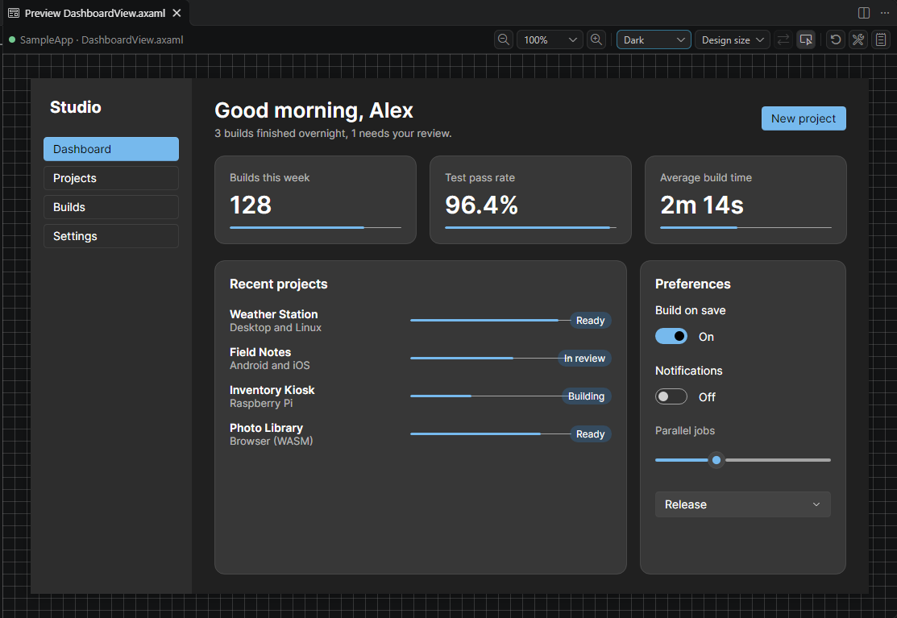

# AXAML Live

Live preview and editor features for Avalonia XAML (`.axaml`) files in Visual Studio Code: a previewer that updates
while you type, completion, diagnostics, hover, go to definition and a formatter.

AXAML Live is a free, MIT-licensed community project, based on the archived open source
[AvaloniaVSCode](https://github.com/AvaloniaUI/AvaloniaVSCode) extension. No account, no telemetry, no C# Dev Kit
needed.

## Requirements

| What | Version | Why |
|---|---|---|
| Visual Studio Code | 1.79 or newer | |
| .NET SDK | 8.0 or newer, the version your project needs | to build your app; the previewer runs your app's build output |
| .NET runtime | 10.0 or newer | for the language server (completion, diagnostics, hover). If it is missing, it is downloaded for you by the .NET Install Tool extension, which is installed automatically |
| Avalonia | 11.x or 12.x | in your project, as NuGet packages or built from source |
| Operating system | Windows, Linux or macOS (x64 or arm64) | also works in Remote - WSL, Remote - SSH, Dev Containers and Codespaces |

Optional: the C# extension (`ms-dotnettools.csharp`) to **Run / Debug** with the debugger. Without it the project is
started in a terminal.

The previewer needs your app to have a `public static AppBuilder BuildAvaloniaApp()` method (the Avalonia templates
have one). If your app starts Avalonia in another way, add that method; `Main` can call it.

## Getting started

Create a project from VS Code (**AXAML Live: Create a new Avalonia Project**) or from the command line:

    dotnet new install Avalonia.Templates
    dotnet new avalonia.mvvm -o MyApp

Open the folder, open an `.axaml` file and click **Show preview** in the editor toolbar (or turn on
`axamlLive.previewer.autoOpen`). If the project was never built, it is built automatically.

## Previewer

- **Live**: changes show while you type, no need to save.
- **Interactive**: mouse, wheel and keyboard go to the previewed UI (turn this off with the mouse button in the toolbar).
- **Sharp zoom**: -/+, Ctrl+Wheel, Fit All, Fit Width. The preview is rendered at the zoomed size, not scaled up.
- **Theme**: preview in the app theme, Light or Dark.
- **Device sizes**: desktop, laptop, phones and tablets, also rotated. Only the preview changes, not your file.
- **Design data**: a view with `x:DataType` (or named like `Views/FooView` with a `ViewModels/FooViewModel`) and no
  `Design.DataContext` is previewed with a new instance of its view model, so bindings show data. If the view model
  cannot be created (for example it needs constructor arguments), the preview says so and shows the view without data.
- **Background**: show transparent views on a light, dark or custom color (`axamlLive.previewer.background`).
- **Builds just work**: the previewer runs from a copy of your build output, so `dotnet build` is never blocked by
  locked files. After any build (toolbar **Build**, terminal, C# Dev Kit) the preview reloads by itself.
- **Errors**: XAML errors are shown under the preview and in the Problems view. If code in your app throws while
  previewing (for example in `OnLoaded`), the preview shows what crashed and starts again.
- **Remote**: works over WSL, SSH and in containers without port forwarding; only the changed part of each frame is sent.
- **.xaml files** that belong to an Avalonia project get the preview and the editor features too.
- One preview follows the active editor. XAML in a library is previewed through an app that references it. Choose
  another app with **AXAML Live: Select previewer host project** (or click the project name in the preview toolbar), the
  `axamlLive.previewer.hostProject` setting, or from `.vscode/launch.json` (`axamlLive.previewer.syncWithLaunchConfig`).

## Editing AXAML

- **Completion** for elements, properties, markup extensions, resources and `x:` directives.
- **Diagnostics without building**: unknown types, properties, events and binding paths (`x:DataType`), with
  **quick fixes** (for example "Change to 'Button'").
- **Hover**: types and properties with their documentation.
- **Go to definition**: `x:Class`, `x:DataType`, types, binding members, event handlers and resource keys.
- **Source-generated members** (for example CommunityToolkit `[ObservableProperty]`) are known as soon as the C#
  file is saved, without a build.
- **Show Code-behind** (F7) and **Show ViewModel** (Shift+F7).
- **Format Document** with attribute wrapping, markup extension wrapping, blank line handling and quote style.
- **Style badges** after elements that a `Style` in the same file applies to; hover a badge to see the selectors.

## Settings

| Setting | Default | |
|---|---|---|
| `axamlLive.previewer.autoOpen` | `false` | open the preview when an .axaml file is opened |
| `axamlLive.previewer.defaultZoom` | `1` | a factor, `"fitAll"` or `"fitWidth"` |
| `axamlLive.previewer.defaultThemeVariant` | `Default` | `Default` (app theme), `Light`, `Dark` |
| `axamlLive.previewer.defaultFormFactor` | `default` | device size (`phone`, `tablet`, ...) |
| `axamlLive.previewer.defaultFormFactorRotated` | `false` | start rotated |
| `axamlLive.previewer.background` | `theme` | `theme`, `light`, `dark` or a color like `#1a1a1a` |
| `axamlLive.previewer.designDataContext` | `true` | preview views with a new instance of their view model |
| `axamlLive.previewer.enableInput` | `true` | send mouse and keyboard input to the preview |
| `axamlLive.previewer.fpsLimit` | `60` | frames per second for animations, 0 = no limit |
| `axamlLive.previewer.maxRenderScale` | `3` | highest render scale when zoomed in |
| `axamlLive.previewer.updateDelay` | `300` | milliseconds before unsaved changes are sent |
| `axamlLive.previewer.buildIfNeeded` | `true` | build automatically when there is no build output |
| `axamlLive.previewer.hostProject` | `""` | the app project that hosts the preview |
| `axamlLive.previewer.syncWithLaunchConfig` | `false` | use the project started by launch.json |
| `axamlLive.build.useInstalledSdk` | `false` | when global.json asks for a .NET SDK that is not installed, build with the installed one |
| `axamlLive.showStyleAdornments` | `true` | show style badges |
| `axamlLive.editor.attributeQuoteStyle` | `double` | quotes used by completion and the formatter |
| `axamlLive.formatting.*` | | attribute wrapping, markup extension wrapping, blank lines |

## Commands

**Show preview**, **Restart previewer**, **Build project and reload preview**, **Run / Debug Project**,
**Show Code-behind**, **Show ViewModel**, **New Avalonia Item...** (Explorer folder menu), **Create a new Avalonia
Project**, **Install / Update Avalonia Project Templates**, **Select solution**, **Select previewer host project**.

## Troubleshooting

- Open **Output -> AXAML Live** (or click the Log button in the preview).
- If the official Avalonia extension is installed as well, you get completion from both; disable one of them for the
  workspace.
- If `global.json` asks for a .NET SDK that is not installed, previews of built projects still work. To build, install
  that SDK or turn on `axamlLive.build.useInstalledSdk`.

## Building and releasing

See [CONTRIBUTING.md](CONTRIBUTING.md) for development. To release:

1. Set `publisher` in `src/AxamlLive/package.json` to your Marketplace publisher ID (create one at
   https://marketplace.visualstudio.com/manage), and use the same ID in `editor.defaultFormatter` under
   `configurationDefaults` (`<publisher>.axaml-live`). The release workflow checks that they match.
2. On GitHub, make the branch you release from the default branch: links in the Marketplace page point to the
   default branch.
3. Update `version` in `package.json` and `CHANGELOG.md`, commit, and push a tag like `v0.2.0`. GitHub Actions builds
   the VSIX and attaches it to a GitHub release.
4. To publish to the Marketplace, add a `VSCE_PAT` secret to the repository and run the **Release** workflow from the
   Actions tab with **publish** checked.

## Trademarks

Avalonia® is a registered trademark of AvaloniaUI OÜ. AXAML Live is a community project and is not affiliated with or
endorsed by AvaloniaUI OÜ. All other trademarks are the property of their respective owners.

## License

MIT, see [LICENSE](LICENSE). Third party components and their licenses are listed in
[THIRD-PARTY-NOTICES.txt](src/AxamlLive/THIRD-PARTY-NOTICES.txt).
