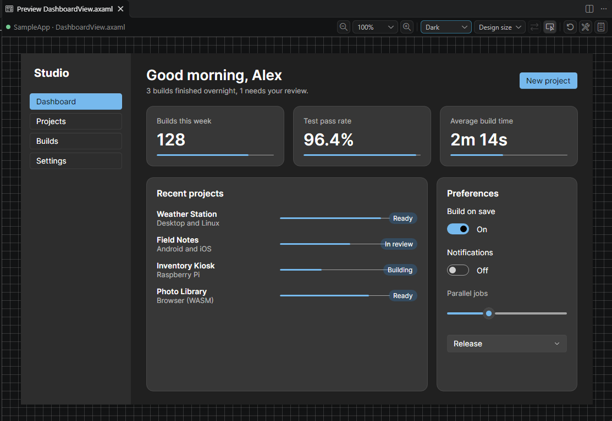

# AXAML Live

A Visual Studio Code extension for Avalonia XAML (`.axaml`) files: a previewer, completion, diagnostics, hover, go
to definition and a formatter.

It is based on the archived [AvaloniaVSCode](https://github.com/AvaloniaUI/AvaloniaVSCode) extension and is licensed
under MIT.

## Requirements

- Visual Studio Code 1.79 or newer
- .NET SDK 8.0 or newer, matching your project
- .NET 10 runtime for the language server. If it is missing, the .NET Install Tool extension downloads it.
- Avalonia 11 or 12
- Windows, Linux or macOS (x64 or arm64). Remote - WSL, Remote - SSH, Dev Containers and Codespaces are supported.

Optional: the C# extension (`ms-dotnettools.csharp`) to **Run / Debug** with the debugger. Without it the project is
started in a terminal.

The previewer needs your app to have a `public static AppBuilder BuildAvaloniaApp()` method (the Avalonia templates
have one). If your app starts Avalonia in another way, add that method; `Main` can call it.

## Getting started

Create a project from VS Code (**AXAML Live: Create a new Avalonia Project**) or from the command line:

    dotnet new install Avalonia.Templates
    dotnet new avalonia.mvvm -o MyApp

Open the folder, open an `.axaml` file and click **Show preview** in the editor toolbar (or turn on
`axamlLive.previewer.autoOpen`). If the project was never built, it is built automatically.

## Previewer

- The preview updates while you type; saving is not needed. To update it only on save, set
  `axamlLive.previewer.updateOn` to `save`.
- Mouse, wheel and keyboard input is sent to the previewed UI. The keyboard button in the toolbar turns this off.
- Select an element (inspect button in the toolbar): click a control in the preview to select its element in the
  editor, also inside views the file uses (the element is selected in that view's file). Esc ends select mode.
- Zoom with -/+ or Ctrl+Wheel, or use Fit All and Fit Width. The preview is rendered at the zoomed size.
- Theme: the app theme, Light or Dark.
- Sizes: the view's design size, Desktop (1920x1080), Phone (390x844) and Tablet (768x1024); landscape with
  `axamlLive.previewer.defaultFormFactorRotated`. Only the preview changes, not the file.
- Custom size: choose Custom in the size menu, then type the width and height, or drag the frame's right edge, bottom
  edge or corner to see how the view behaves when its window is resized. The size is remembered.
- Rulers (ruler button in the toolbar): along the top and left edges, in the view's pixels, 0 at the frame's corner.
- Design data: a view with `x:DataType` (or named like `Views/FooView` with a `ViewModels/FooViewModel`) and no
  `Design.DataContext` is previewed with a new instance of its view model. If the view model cannot be created, for
  example because it needs constructor arguments, the preview shows the view without data and says why. The quick fix
  on `x:DataType` creates a design-time view model for it.
- Background for transparent views: light, dark or a custom color (`axamlLive.previewer.background`).
- The previewer runs from a copy of the build output, so `dotnet build` is not blocked by locked files. After a build
  (toolbar **Build**, terminal, C# Dev Kit) the preview reloads.
- XAML errors are shown under the preview and in the Problems view. If code in the app throws while previewing (for
  example in `OnLoaded`), the preview shows the error and the previewer restarts.
- Works over Remote - WSL, Remote - SSH and in containers.
- `.xaml` files that belong to an Avalonia project are supported too.
- One preview follows the active editor. XAML in a library is previewed through an app that references it. To choose
  another app, use **AXAML Live: Select previewer host project** (or click the project name in the preview toolbar),
  the `axamlLive.previewer.hostProject` setting, or `.vscode/launch.json` (`axamlLive.previewer.syncWithLaunchConfig`).

## Editing AXAML

- Completion for elements, properties, markup extensions and `x:` directives.
- Completion of binding paths at any depth (`Customer.Address.City`), also in data templates with `x:DataType`, from
  the C# source (no build needed).
- Completion of resource keys (`{StaticResource ...}`) from this file, the project's other .axaml files and the themes;
  go to definition and hover also find keys in other files.
- Completion in style selectors (types, `.classes`, `:pseudo-classes`, `#names`, controls after `/template/`) and
  in `Classes="..."`, with the classes used in the project's .axaml files.
- The type of compiled bindings is shown after them (`{Binding Name} : string`). Turn this off with
  `editor.inlayHints.enabled`.
- Diagnostics without building: unknown types, properties, events and binding paths (`x:DataType`), with quick fixes
  (for example "Change to 'Button'").
- Hover with type and property documentation.
- Go to definition for `x:Class`, `x:DataType`, types, binding members, event handlers and resource keys.
- Source-generated members (for example CommunityToolkit `[ObservableProperty]`) are known after the C# file is saved,
  without a build.
- Show Code-behind (F7) and Show ViewModel (Shift+F7).
- Outline view, breadcrumbs and Go to Symbol (Ctrl+Shift+O) for the element tree.
- Snippets: `style`, `style^`, `setter`, `ct` (ControlTheme), `datatemplate`, `itemtemplate`, `designdc`, `grid`,
  `resources`, `transitions`, `binding`.
- The language server state is shown in the status bar (`{}` next to the language); click it to restart.
- Format Document, with options for attribute wrapping, markup extension wrapping, blank lines and quote style.
- Style badges after elements that a `Style` in the same file applies to; hovering a badge shows the selectors.

## Settings

| Setting | Default | |
|---|---|---|
| `axamlLive.previewer.autoOpen` | `false` | open the preview when an .axaml file is opened |
| `axamlLive.previewer.defaultZoom` | `1` | a factor, `"fitAll"` or `"fitWidth"` |
| `axamlLive.previewer.defaultThemeVariant` | `Default` | `Default` (app theme), `Light`, `Dark` |
| `axamlLive.previewer.defaultFormFactor` | `default` | device size (`phone`, `tablet`, ...) |
| `axamlLive.previewer.defaultFormFactorRotated` | `false` | start rotated |
| `axamlLive.previewer.background` | `theme` | `theme`, `light`, `dark` or a color like `#1a1a1a` |
| `axamlLive.previewer.designDataContext` | `true` | preview views with a new instance of their view model |
| `axamlLive.previewer.enableInput` | `true` | send mouse and keyboard input to the preview |
| `axamlLive.previewer.fpsLimit` | `60` | frames per second for animations, 0 = no limit |
| `axamlLive.previewer.maxRenderScale` | `3` | highest render scale when zoomed in |
| `axamlLive.previewer.updateOn` | `change` | `change`: update while you type, `save`: update when the file is saved |
| `axamlLive.previewer.updateDelay` | `300` | milliseconds before unsaved changes are sent |
| `axamlLive.previewer.buildIfNeeded` | `true` | build automatically when there is no build output |
| `axamlLive.previewer.hostProject` | `""` | the app project that hosts the preview |
| `axamlLive.previewer.syncWithLaunchConfig` | `false` | use the project started by launch.json |
| `axamlLive.build.useInstalledSdk` | `false` | when global.json asks for a .NET SDK that is not installed, build with the installed one |
| `axamlLive.showStyleAdornments` | `true` | show style badges |
| `axamlLive.editor.attributeQuoteStyle` | `double` | quotes used by completion and the formatter |
| `axamlLive.formatting.*` | | attribute wrapping, markup extension wrapping, blank lines |

## Commands

**Show preview**, **Run Project** (play button in the editor title bar: builds and starts the app), **Restart
previewer**, **Build project and reload preview**, **Run / Debug Project**,
**Show Code-behind**, **Show ViewModel**, **New Avalonia Item...** (Explorer folder menu), **Create a new Avalonia
Project**, **Install / Update Avalonia Project Templates**, **Select solution**, **Select previewer host project**.

## Troubleshooting

- Open **Output -> AXAML Live** (or click the Log button in the preview).
- If the official Avalonia extension is installed as well, you get completion from both; disable one of them for the
  workspace.
- If `global.json` asks for a .NET SDK that is not installed, previews of built projects still work. To build, install
  that SDK or turn on `axamlLive.build.useInstalledSdk`.

## Trademarks

Avalonia® is a registered trademark of AvaloniaUI OÜ. AXAML Live is a community project and is not affiliated with or
endorsed by AvaloniaUI OÜ. All other trademarks are the property of their respective owners.

## License

MIT, see [LICENSE](LICENSE). Third party components and their licenses are listed in
[THIRD-PARTY-NOTICES.txt](https://github.com/orestbida/axaml-live/blob/HEAD/src/AxamlLive/THIRD-PARTY-NOTICES.txt).
